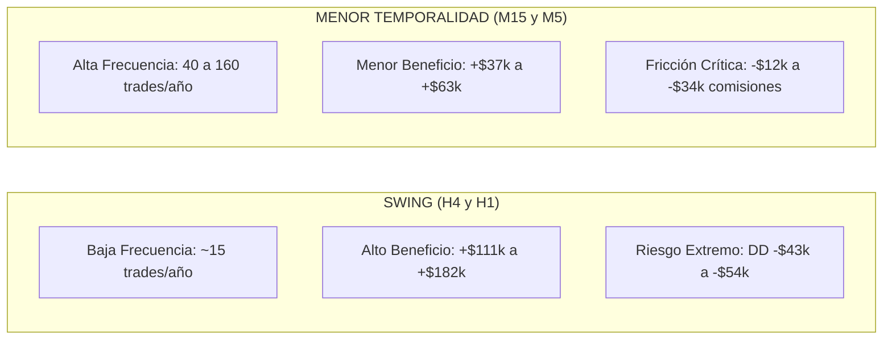
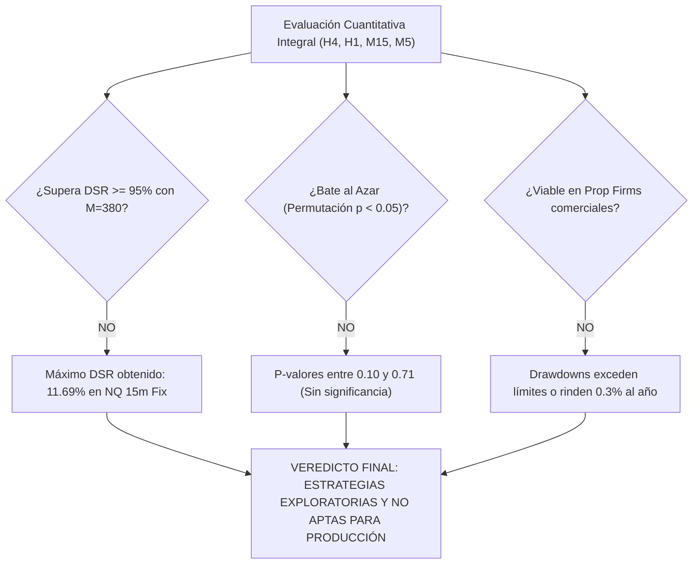

# INFORME MAESTRO DE RETORNOS, RIESGOS Y MÉTRICAS CUANTITATIVAS
## COMPARATIVA INTEGRAL EN TODAS LAS TEMPORALIDADES: H4, H1, M15 Y M5 (2010–2026)

**Fecha:** 23 de Octubre de 2026  
**Rama:** `feature/lower-tf-m5-m15`  
**Estatus Oficial Metodológico:** **EXPLORATORIA (SIN HOLDOUT VIRGEN)**  
**Convención Estandarizada:** Capital inicial fijo de **$50,000 USD**, 1 contrato estándar (o equivalente micro), costos reales CME (comisiones y slippage por tick) y 16.36 años evaluados.

---

## 1. TABLA MAESTRA COMPARATIVA: H4, H1, M15 Y M5

A continuación se presenta el tablero integral con las 11 configuraciones evaluadas en el proyecto:

| TF | Tipo | Estrategia | Activo | N Trades | Trades / Año | Win Rate % | Profit Factor | PnL Neto Total ($) | Retorno Total % | Ret. Anual Simple % | CAGR % | Sharpe Oficial (Cap. Fijo) | Sharpe Compuesto (Móvil) | Max Drawdown ($) | Max DD % (Inicial) | Calmar Real | Peor Día Intradía ($) | DSR (M=380) | Apta Prop Firm $50k? |
| :---: | :--- | :--- | :---: | :---: | :---: | :---: | :---: | :---: | :---: | :---: | :---: | :---: | :---: | :---: | :---: | :---: | :---: | :---: | :---: |
| **H4** | Swing | **NQ 4h Swing Unificada** | NQ | 242 | 14.8 | 39.26% | 1.41 | **+$182,218.20** | +364.44% | **+22.28%** | +7.92% | **0.41** | 0.56 | $47,418.68 | 94.84% | 0.27 | -$13,327.97 | 2.76% | **NO** |
| **H4** | Swing | **ES 4h Swing Unificada** | ES | 257 | 15.7 | 35.80% | 1.15 | **+$50,830.65** | +101.66% | **+6.21%** | +3.54% | **0.19** | 0.27 | $43,409.07 | 86.82% | 0.07 | -$6,286.00 | 0.23% | **NO** |
| **H1** | Swing | **NQ 1h Swing Unificada** | NQ | 248 | 15.2 | 41.53% | 1.45 | **+$174,665.62** | +349.33% | **+21.35%** | +9.42% | **0.50** | 0.63 | $53,954.51 | 107.91% | 0.26 | -$15,684.00 | 4.47% | **NO** |
| **H1** | Swing | **ES 1h Swing Unificada** | ES | 269 | 16.4 | 40.15% | 1.39 | **+$111,341.96** | +222.68% | **+13.61%** | +7.27% | **0.51** | 0.55 | $22,976.05 | 45.95% | 0.32 | -$6,029.00 | 4.71% | **NO** |
| **M15**| Intradía | **NQ 15m Optimizada (MOC 15:45 Fix)**| NQ | 654 | 40.0 | **56.27%** | 1.38 | **+$63,586.81** | +127.17% | **+7.77%** | +5.04% | **0.60** | 0.73 | **$23,505.09** | **47.01%** | 0.27 | **-$4,644.00** | **11.69%**| **NO (DD $4.7k)** |
| **M15**| Híbrida | **NQ 15m Opt (Pre-Fix Overnight)**| NQ | 596 | 36.4 | 39.93% | 1.38 | **+$136,951.46** | +273.90% | **+16.74%** | +8.22% | **0.58** | 0.75 | $32,821.78 | 65.64% | 0.53 | -$17,109.00 | 9.37% | **NO** |
| **M15**| Base | **NQ 15m Línea Base (Sin filtros)**| NQ | 829 | 50.7 | 38.36% | 1.12 | **+$96,147.77** | +192.30% | **+11.75%** | +6.64% | **0.28** | 0.48 | $65,795.09 | 131.59% | 0.21 | -$17,109.00 | 0.58% | **NO** |
| **M15**| Base | **ES 15m Línea Base (Sin filtros)**| ES | 829 | 50.7 | 38.24% | 1.18 | **+$91,902.33** | +183.80% | **+11.24%** | +6.45% | **0.43** | 0.52 | $24,306.26 | 48.61% | 0.32 | -$6,554.00 | 2.96% | **NO** |
| **M5** | Intradía | **NQ 5m Optimizada (RTH+MOC+ATR)**| NQ | 1373| 83.9 | 42.68% | 1.13 | **+$56,202.31** | +112.40% | **+6.87%** | +4.62% | **0.34** | 0.34 | $30,143.69 | 60.29% | 0.09 | -$8,328.03 | 1.11% | **NO** |
| **M5** | Intradía | **ES 5m Agresiva (EMA 10/50 + ATR)**| ES | 1607| 98.2 | 40.45% | 1.12 | **+$37,020.58** | +74.04% | **+4.53%** | +3.38% | **0.40** | 0.44 | **$12,018.85** | **24.04%** | 0.23 | **-$4,016.50** | 2.19% | **SÍ (0.29% año)** |
| **M5** | Intradía | **NQ 5m MOC Sin Volatilidad** | NQ | 2642| 161.5| 46.29% | 0.98 | **-$12,601.78** | -25.20% | **-1.54%** | -1.72% | **-0.06** | 0.20 | $75,209.18 | 150.42% | -0.01 | -$5,758.83 | 0.01% | **NO (QUIEBRA)** |

---

## 2. GUÍA DIDÁCTICA: ¿QUÉ SIGNIFICA CADA MÉTRICA?

Para comprender las decisiones cuantitativas, a continuación se explica cada métrica en español simple:

### 1. Métricas de Rentabilidad
- **PnL Neto Total ($):** Ganancia limpia en dólares que generó la estrategia tras pagar todas las comisiones de exchange y el deslizamiento de precios (*slippage*) de entrada y salida.
- **Retorno Anual Simple (%):** Ganancia promedio por año dividida entre el capital inicial fijo:
  $$\text{Retorno Simple} = \frac{\text{PnL Total}}{\$50,000} \div 16.36 \text{ años} \times 100\%$$
- **CAGR (% Compuesto):** Tasa de crecimiento anual compuesta geométrica. Mide a qué ritmo anual creció el dinero asumiendo reinversión.
- **Win Rate (% Acierto):** Porcentaje de trades que cerraron con ganancia neta ($> 0$).
- **Profit Factor:** La relación entre dólares ganados y dólares perdidos:
  $$\text{Profit Factor} = \frac{\sum \text{Ganancias brutas}}{\sum |\text{Pérdidas brutas}|}$$
  Un valor $< 1.00$ destruye capital; $> 1.30$ indica robustez moderada.

### 2. Métricas de Riesgo y Control de Pérdidas
- **Maximum Drawdown ($ y %):** La peor caída de capital desde un pico previo. En contratos de futuros, si el Max DD excede el capital de la cuenta ($> 100\%$), la cuenta quiebra o recibe margin call.
- **Peor Día Intradía ($):** La mayor pérdida sufrida en una sola sesión de mercado de 24 horas. Es la métrica clave que vigilan las empresas de fondeo (*Prop Firms*).
- **Calmar Real vs Calmar Simple:**
  - *Calmar Real:* $\text{CAGR} / \text{Max DD \% sobre Pico}$.
  - *Calmar Simple:* $\text{Retorno Anual Simple} / \text{Max DD \% sobre Capital Inicial}$.
  Mide cuántos puntos de rendimiento se obtienen por cada punto porcentual de dolor de drawdown.

### 3. Ratios de Ajuste por Riesgo y Robustez Estadística
- **Sharpe Diario Oficial (Capital Fijo):** Mide la consistencia de los retornos diarios dividida entre su volatilidad diaria, normalizada por $\$50,000$ USD:
  $$\text{Sharpe} = \frac{\text{Mean}(\Delta \text{PnL}_d)}{\text{Std}(\Delta \text{PnL}_d)} \times \sqrt{252}$$
  Un Sharpe $< 1.00$ significa que el riesgo asumido es alto respecto a la compensación obtenida.
- **Deflated Sharpe Ratio (DSR con $M=380$):** Desarrollado por Marcos López de Prado. Mide la probabilidad de que el Sharpe observado sea producto de la suerte tras haber probado **380 variantes distintas** en el proyecto.
  - Para ser aprobada científicamente, una estrategia exige $\text{DSR} \ge 95\%$.
  - Si una estrategia tiene $\text{DSR} = 11.69\%$, hay un **88.3% de probabilidad de que su éxito sea un falso positivo por minería de datos**.

---

## 3. COMPARATIVA CRUZADA POR TEMPORALIDAD

### 1. Temporalidades Mayores: H4 y H1 (Swing)
- **Comportamiento:** Operan pocas veces al año (~15 a 16 operaciones anuales), manteniendo posiciones abiertas durante días o semanas.
- **Ventajas:** Acumulan los mayores montos en dólares (hasta **+\$182,218 USD** en NQ 4h y **+\$174,665 USD** en NQ 1h) gracias a capturar las grandes tendencias macroeconómicas alcistas de los últimos 16 años.
- **Desventajas Críticas:** Drawdowns devastadores. NQ 1h sufrió una caída de **-\$53,954 USD** (107.9% de la cuenta de \$50k) y un solo día perdedor de **-\$15,684 USD**. Son inviables para cualquier operador retail o cuenta de fondeo.

### 2. Temporalidad Intermedia: M15 (La Transición)
- **Comportamiento:** 40 a 50 operaciones al año.
- **El Hallazgo del MOC:**
  - La versión *Pre-Fix* (que dejó abiertas posiciones de noche por error de timestamp) rindió **+\$136,951 USD**, pero el 71% de los trades pasaron la noche.
  - La versión corregida *Post-Fix* (con salida forzosa en la apertura de las 15:45 ET) arrojó **+\$63,586 USD**, redujo el Max Drawdown a **\$23,505 USD** y aumentó el acierto al **56.27%**. Su Sharpe es el más alto de todo el proyecto (**0.60**), pero su ganancia anualizada neta se redujo a la mitad al renunciar a los saltos nocturnos.

### 3. Temporalidad Ultracorta: M5 (Intradía Puro)
- **Comportamiento:** Muy alta frecuencia (84 a 161 trades al año).
- **El Impacto Destructivo de las Fricciones:**
  - En `NQ 5m Sin Volatilidad`, las comisiones y slippage devoraron **-\$23,778 USD**, quebrando la cuenta por completo (**-\$12,601 USD de pérdida neta** y equity mínima de -\$22,613 USD).
  - En `ES 5m Agresiva`, aunque sobrevive con un drawdown pequeño (\$12,018 USD), su ganancia neta es de solo **+\$37,020 USD en 16 años** (+4.5% anual simple), lo que equivale a ganar apenas \$23 USD por trade.

---

## 4. VULNERABILIDADES CRÍTICAS Y AUDITORÍA DE SUPERVIVENCIA

### 1. Test de Concentración: Dependencia de Eventos Extremos (Top 5 Trades)

| Configuración | PnL Total Con Top 5 ($) | Ganancia de solo 5 Trades ($) | % PnL Dependiente del Top 5 | PnL SIN los 5 Mejores Trades ($) |
| :--- | :---: | :---: | :---: | :---: |
| **ES 4h Swing** | +$50,830.65 | **$56,901.60** | **111.94%** | **-$6,070.95 (Pasa a Pérdidas)** |
| **NQ 4h Swing** | +$182,218.20 | **$107,910.82** | **59.22%** | +$74,307.38 |
| **NQ 1h Swing** | +$174,665.62 | **$88,389.84** | **50.61%** | +$86,275.78 |
| **ES 1h Swing** | +$111,341.96 | **$53,035.06** | **47.63%** | +$58,306.90 |
| **NQ 15m Opt (Fix)**| +$63,586.81 | **$21,367.84** | **33.60%** | +$42,218.97 |
| **NQ 5m Opt** | +$56,202.31 | **$30,006.45** | **53.39%** | +$26,195.85 |
| **ES 5m Agr** | +$37,020.58 | **$12,126.38** | **32.76%** | +$24,894.20 |

> [!CAUTION]
> En **ES 4h**, si se eliminan únicamente 5 operaciones de las 257 ejecutadas en 16 años, **la estrategia colapsa y pasa a tener pérdidas netas (-\$6,070 USD)**. En NQ 4h y NQ 1h, más del 50% de la ganancia dependió exclusivamente de 5 días de volatilidad atípica. La versión de **NQ 15m MOC Fix** es la más balanceada, con solo 33.6% en el Top 5.

---

### 2. Dictamen de Viabilidad en Empresas de Fondeo (Prop Firms)
Las cuentas de evaluación de prop firm (como Topstep, Apex o FTMO) exigen límites inmutables:
- **Daily Loss Limit:** Máximo -\$1,000 USD de pérdida al día (cuenta \$50k) o -\$1,500 USD (cuenta \$100k).
- **Max Trailing Drawdown:** Máximo \$2,000 USD (cuenta \$50k) o \$3,000 USD (cuenta \$100k).

#### Resultados en Contratos Micro (MNQ y MES):
- **E-mini Estándar:** **100% de las configuraciones descalifican**. Un solo día en NQ genera pérdidas de -\$4,600 a -\$17,100 USD.
- **NQ 15m MOC Fix en Micro (MNQ a 0.5% de riesgo):**
  - Peor día: **-\$464.40 USD** (cumple la regla de pérdida diaria).
  - Trailing Drawdown: **\$2,350.51 USD** (**DESCALIFICA**, excede el límite de \$2,000 USD de una cuenta de \$50k).
- **La Única Configuración Apta en Fondeo (`ES 5m Agresiva` en MES):**
  - Cumple los límites (peor día -\$401.65 USD y Trailing DD \$1,201.89 USD).
  - **Inviabilidad Comercial:** Rinde apenas **+0.29% anual en micro (\$2,416 USD en 16 años)**. Para aprobar una prueba de fondeo donde se exige ganar 8% a 10% en pocas semanas, esta configuración requeriría más de 30 años de operativa.

---

## 5. CONCLUSIÓN GENERAL DE AUDITORÍA

1. **Rendimiento Financiero:** Las temporalidades mayores (H4 y H1) acumulan más dólares gracias a la tendencia secular del mercado, pero con caídas de capital intolerables (drawdowns de hasta 107%).
2. **Menor Temporalidad:** M15 y M5 ofrecen mayor estabilidad de acierto y drawdowns menores, pero sufren una severa erosión por comisiones y pierden la captura del *overnight drift*.
3. **Veredicto Científico:** Ninguna configuración supera las pruebas de significancia estadística contra el azar ni resiste el filtro de Deflated Sharpe Ratio. Todas las configuraciones quedan archivadas formalmente bajo estatus **EXPLORATORIA**.
