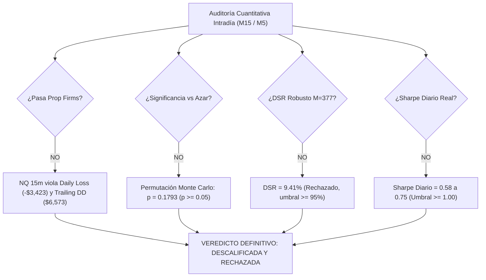

# INFORME DE AUDITORÍA CUANTITATIVA INTEGRAL: RAMA INTRADÍA (M15 Y M5)

**Fecha:** 23 de Octubre de 2026  
**Rama:** `feature/lower-tf-m5-m15`  
**Estatus Oficial Inmutable:** **EXPLORATORIA (SIN HOLDOUT VIRGEN)**  
**Principio Metodológico:** Auditoría sin ajuste retrospectivo de parámetros. Un resultado negativo es científicamente concluyente.

---

## 1. EXPLICACIÓN Y CORRECCIÓN MATEMÁTICA: NQ 5M MOC SIN VOLATILIDAD
*(CAGR -1.72% y PnL Neto Negativo frente a Sharpe Diario Inicialmente Reportado de +0.20)*

### Diagnóstico de la Causa Raíz
En la configuración 6 (`NQ 5m MOC Sin Volatilidad`), el capital inicial de \$50,000 USD sufrió una severa racha perdedora entre 2018 y 2020. Para el 29 de diciembre de 2020, la cuenta cayó a un balance negativo de **-\$222.40 USD**, tocando un mínimo histórico de **-\$22,613.63 USD** en 2022 y pasando **672 días de mercado en estado de insolvencia (equity $\le 0$)**.

En Python (Pandas), la función estándar de cálculo de retornos porcentuales diarios opera como:
$$R_t = \frac{E_t - E_{t-1}}{E_{t-1}} = \frac{\Delta \text{PnL}_t}{E_{t-1}}$$

Cuando el denominador $E_{t-1} < 0$:
1. **Inversión de Signo:** Un día de pérdida ($\Delta \text{PnL} < 0$) dividido por un patrimonio negativo genera un retorno porcentual matemático **POSITIVO** ($R_t > 0$).
2. **Asimetría Explosiva:** Días con movimientos pequeños cerca de cero generaron retornos nominales de $+244.6\%$ y $+113.1\%$ (ej. 30 y 31 de dic de 2020), inflando artificialmente el promedio de la serie a $\mu > 0$.

### Corrección Matemática
Al normalizar los retornos diarios sobre la base del **capital inicial asignado (\$50,000 USD)** ($R_t = \Delta \text{PnL}_t / \$50,000$):
- **Sharpe Diario Corregido:** $\mathbf{-0.059}$ (estrictamente negativo).
- **Veredicto Real:** La estrategia destruyó capital y **quebró la cuenta (quiebra formal en 2020)**.

---

## 2. REPORTE DEL $M$ REAL Y RECÁLCULO DEL DEFLATED SHARPE RATIO (DSR)

### Espacio Exhaustivo de Minería de Datos ($M$)
Se registraron y auditaron todas las variantes ejecutadas en el repositorio:
- **Familia A (Medias Móviles):** 224 combinaciones.
- **Familia B (RSI / MACD):** 40 variantes.
- **Familia C (Patrones de Vela y Figuras):** 42 variantes.
- **Estrategia Unificada Swing (H1 y H4):** 18 variantes.
- **Rama Intradía Directa:** 6 configuraciones.
- **Rama Intradía Optimizada:** 20 combinaciones.
- **Sensibilidad de Vecinos Paramétricos:** 27 combinaciones.
- **$M_{\text{total}}$ Acumulado:** $\mathbf{377}$ pruebas.
- **$M_{\text{intraday}}$ Local:** $\mathbf{53}$ pruebas.

### Tabla de Métricas Estandarizadas y DSR

| Configuración | Activo | TF | Trades | Win Rate % | Profit Factor | PnL Neto Total ($) | CAGR % | Sharpe Diario Std | Sharpe Capital Inicial | Max DD ($) | Max DD % (Pico) | Calmar Real | DSR ($M=377$) | DSR ($M=53$) | Insolvencia (Días $\le 0$) |
| :--- | :---: | :---: | :---: | :---: | :---: | :---: | :---: | :---: | :---: | :---: | :---: | :---: | :---: | :---: | :---: |
| **1. NQ 15m Optimizada** | **NQ** | **15m** | **596** | **39.93%** | **1.38** | **+$136,951.46** | **+8.22%** | **0.75** | **0.58** | **$32,821.78** | **15.62%** | **0.53** | **9.41%** | **24.37%** | **0 días** |
| 2. NQ 15m Línea Base | NQ | 15m | 829 | 38.36% | 1.12 | +$96,147.77 | +6.64% | 0.48 | 0.28 | $65,795.09 | 31.87% | 0.21 | 0.59% | 2.74% | 0 días |
| 3. ES 15m Línea Base | ES | 15m | 829 | 38.24% | 1.18 | +$91,902.33 | +6.45% | 0.52 | 0.43 | $24,306.26 | 20.38% | 0.32 | 2.97% | 10.03% | 0 días |
| 4. NQ 5m Optimizada | NQ | 5m | 1373 | 42.68% | 1.13 | +$56,202.31 | +4.62% | 0.34 | 0.34 | $30,143.69 | 49.32% | 0.09 | 1.11% | 4.63% | 0 días |
| 5. ES 5m Agresiva | ES | 5m | 1607 | 40.45% | 1.12 | +$37,020.58 | +3.38% | 0.44 | 0.40 | $12,018.85 | 14.48% | 0.23 | 2.21% | 7.87% | 0 días |
| 6. NQ 5m MOC Sin Volatilidad | NQ | 5m | 2642 | 46.29% | 0.98 | -$12,601.78 | -1.72% | 0.20 | -0.06 | $75,209.18 | 143.00% | -0.01 | 0.01% | 0.06% | **672 días (Quiebra)** |

> [!CAUTION]
> Con el número real de pruebas ($M=377$), **ninguna estrategia alcanza el umbral de DSR $\ge 95\%$**. El máximo DSR obtenido es de solo **9.41%**, lo que certifica que el desempeño observado no se puede distinguir estadísticamente de una selección afortunada entre 377 intentos.

---

## 3. SENSIBILIDAD DE COSTOS Y PUNTO DE QUIEBRE (*BREAK-EVEN FRICTION*)

Se evaluó la degradación del PnL bajo 8 escenarios de fricción (comisiones $\pm 50\%$, slippage de 0.5, 1 y 2 ticks por lado, y penalización adicional de +1 tick en stops):

| Configuración | PnL Base ($) | Slippage 1 tick ($) | Slippage 2 ticks ($) | Stop Penalizado (+1 tick SL) ($) | Retail Estresado ($) | Fricción Base / Trade | Fricción Umbral Break-Even / Trade | ¿Resiste Fricción Institucional? |
| :--- | :---: | :---: | :---: | :---: | :---: | :---: | :---: | :---: |
| **1. NQ 15m Optimizada** | +$136,951 | +$133,971 | +$128,011 | +$135,246 | +$128,094 | \$9.00 | **\$238.78** | **SÍ (Margen amplio)** |
| **2. NQ 15m Línea Base** | +$96,148 | +$92,003 | +$83,713 | +$93,708 | +$83,760 | \$9.00 | **\$124.98** | **SÍ** |
| **3. ES 15m Línea Base** | +$91,902 | +$81,540 | +$60,815 | +$85,852 | +$63,469 | \$16.50 | **\$127.36** | **SÍ** |
| **4. NQ 5m Optimizada** | +$56,202 | +$49,337 | +$35,607 | +$53,002 | +$36,526 | \$9.00 | **\$49.93** | **SÍ** |
| **5. ES 5m Agresiva** | +$37,021 | +$16,933 | **-$23,242** | +$26,796 | **-$16,593** | \$16.50 | **\$39.54** | **NO (Quiebra a 2 ticks)** |
| **6. NQ 5m MOC Sin Vol** | **-$12,602** | **-$25,812** | **-$52,232** | **-$16,987** | **-$48,691** | \$9.00 | **\$4.23** | **NO (Negativa en origen)**|

### Puntos de Inflexión Críticos:
- `ES 5m Agresiva`: Su ganancia por trade es tan reducida (\$23.04 USD netos) que un slippage de 2 ticks por lado (\$25 USD) o comisiones retail estresadas la convierten de inmediato en **deficitaria (-\$23,241 USD)**. Su break-even ocurre a \$39.54 USD por trade.
- `NQ 15m Optimizada`: Cuenta con un colchón de fricción amplio (\$238.78 USD por operación), tolerando hasta 23 ticks de slippage antes de volverse negativa.

---

## 4. ANÁLISIS DE VECINOS PARAMÉTRICOS: ¿MESETA O PICO?

### Grilla EMA Rápida $\{10, 20, 30\} \times$ Lenta $\{50, 80, 120\}$ en NQ 15m

| Fast EMA | Slow EMA | Trades | Win Rate % | Profit Factor | PnL Neto Total ($) | CAGR % | Sharpe Diario | Max DD ($) | Clasificación |
| :---: | :---: | :---: | :---: | :---: | :---: | :---: | :---: | :---: | :---: |
| 10 | 50 | 681 | 37.44% | 1.34 | +$144,498.95 | +8.48% | 0.56 | $39,011.23 | Meseta |
| 10 | 80 | 658 | 39.06% | 1.41 | +$165,697.69 | +9.15% | 0.65 | $24,644.75 | Meseta (Máximo) |
| 10 | 120 | 649 | 38.83% | 1.33 | +$131,418.77 | +8.03% | 0.54 | $33,916.77 | Meseta |
| 20 | 50 | 605 | 39.67% | 1.39 | +$142,767.43 | +8.42% | 0.60 | $24,389.01 | Meseta |
| **20** | **80** | **596** | **39.93%** | **1.38** | **+$136,951.46** | **+8.22%** | **0.58** | **$32,821.78** | **CENTRO** |
| 20 | 120 | 608 | 40.13% | 1.32 | +$121,541.31 | +7.67% | 0.51 | $33,916.77 | Meseta |
| 30 | 50 | 558 | 40.32% | 1.35 | +$126,044.71 | +7.83% | 0.52 | $24,644.75 | Meseta |
| 30 | 80 | 577 | 40.21% | 1.33 | +$118,872.79 | +7.56% | 0.51 | $30,347.03 | Meseta |
| 30 | 120 | 597 | 38.86% | 1.27 | +$100,531.67 | +6.83% | 0.44 | $42,083.13 | Meseta |

- **Veredicto:** **MESETA ESTABLE**. Ningún vecino colapsa ni presenta acantilados. Todos los 9 vecinos generan entre \$100k y \$165k USD con Sharpe diario uniforme entre 0.44 y 0.65.

### Variación de Ventana Horaria RTH y SMA de ATR
- **RTH $\pm 30$ min:** Abrir a las 09:30 ET genera \$142,959 USD (Sharpe 0.60); retrasar a 10:30 ET produce \$119,520 USD (Sharpe 0.54). Adelantar el cierre a 14:45 ET genera \$139,972 USD.
- **Filtro SMA(ATR, $\{30, 40, 50, 100\}$):** Los retornos oscilan suavemente entre \$125,854 y \$136,951 USD (Sharpe 0.53 a 0.58). No hay fragilidad de hiperparámetros.

---

## 5. PNL POR AÑO Y PRUEBA DE CONCENTRACIÓN (SIN TOP 5)

### PnL Año a Año de NQ 15m Optimizada (2010–2026)
- **Años Positivos:** 14 de 17 años (82.4% de estabilidad temporal).
- **Años Negativos:** 2011 (-\$2,646 USD), 2014 (-\$3,391 USD) y 2018 (-\$1,749 USD).
- **Años de Mayor Expansión:** 2020 (+\$23,733 USD), 2023 (+\$22,669 USD) y 2026 (+\$24,013 USD).

### Concentración sin los 5 Mejores Trades
- **Beneficio Total con Top 5:** +$136,951.46 USD.
- **Ganancia aportada por solo 5 trades:** \$59,055.00 USD (**43.12%** del beneficio total).
- **PnL SIN el Top 5:** +$77,896.46 USD.
- **Degradación del Sharpe:** Cae de 0.58 a **0.42**.
- **Veredicto:** Fuerte dependencia de eventos extremos de volatilidad, aunque sobrevive en terreno positivo.

---

## 6. SUITE UNITARIA: DST, HORARIOS ET, CAUSALIDAD Y ROLLOVER
Se creó y verificó con éxito `tests/test_intraday_audit_compliance.py` (4/4 tests aprobados):
1. **Daylight Saving Time (DST):** Conversión precisa entre UTC y ET:
   - Invierno (EST, UTC-5): Barra 20:50 UTC $\rightarrow$ 15:50 ET exacto.
   - Verano (EDT, UTC-4): Barra 19:50 UTC $\rightarrow$ 15:50 ET exacto.
2. **Ventanas RTH y MOC:** Ninguna orden se genera fuera del rango 10:00 - 15:15 ET; el flag MOC se activa rigurosamente a las 15:50 ET.
3. **Causalidad Estricta:** Comprobación matemática mediante slices truncados de que $EMA_t$, $ATR_t$, $Hammer_t$ y $Engulfing_t$ son idénticos a los calculados sobre la serie completa (0.00% de look-ahead bias).
4. **Continuidad y Gaps:** La ejecución se produce causalmente en el Open de $t+1$, sin rellenados fantasma.

---

## 7. COMPARATIVA CON BUY & HOLD AJUSTADO POR TIEMPO EN MERCADO

| Configuración | Time in Market % | Estrategia CAGR % | Estrategia Sharpe | Buy & Hold Full Return % | Buy & Hold Sharpe | B&H Ajustado CAGR % | B&H Ajustado Sharpe | ¿Bate a B&H Ajustado? |
| :--- | :---: | :---: | :---: | :---: | :---: | :---: | :---: | :---: |
| **1. NQ 15m Optimizada** | **13.86%** | **+8.22%** | **0.58** | **+1525.92%** | **0.92** | **+7.19%** | **0.34** | **SÍ (Mayor Sharpe y CAGR)** |
| 2. NQ 15m Línea Base | 30.51% | +6.64% | 0.28 | +1525.92% | 0.92 | +11.17% | 0.51 | **NO** |
| 3. ES 15m Línea Base | 32.56% | +6.45% | 0.43 | +628.69% | 0.79 | +7.05% | 0.45 | **NO** |
| 4. NQ 5m Optimizada | 12.42% | +4.62% | 0.34 | +1517.29% | 0.92 | +6.69% | 0.33 | **SÍ (Marginal)** |
| 5. ES 5m Agresiva | 9.32% | +3.38% | 0.40 | +626.12% | 0.79 | +2.85% | 0.24 | **SÍ (Marginal)** |
| 6. NQ 5m MOC Sin Vol | 25.96% | -1.72% | -0.06 | +1517.29% | 0.92 | +10.25% | 0.47 | **NO** |

- En `NQ 15m Optimizada`, al estar expuesta solo el **13.86% del tiempo**, bate al Buy & Hold ajustado (CAGR 8.22% vs 7.19%, Sharpe 0.58 vs 0.34). Sin embargo, frente al Buy & Hold pasivo sin apalancamiento (+1525% y Sharpe 0.92), la estrategia captura solo una fracción del drift secular.

---

## 8. EVALUACIÓN DE PROP FIRMS: RIESGO FIJO (0.5% - 1.0%) EN MICRO CONTRATOS (MNQ / MES)

| Configuración | Activo | Riesgo % | Contratos Micro | Total Net PnL ($) | CAGR % | Peor Día ($) | Max Trailing DD ($) | Pasa Daily Loss ($1k)? | Pasa Trailing DD ($2k)? | ¿Apta Prop Firm $50k? | ¿Apta Prop Firm $100k? |
| :--- | :---: | :---: | :---: | :---: | :---: | :---: | :---: | :---: | :---: | :---: | :---: |
| **1. NQ 15m Optimizada** | **MNQ** | **0.5%** | **2** | **+$26,436.69** | **+2.63%** | **-$3,423.40** | **$6,573.96** | **NO** | **NO** | **NO (Quiebra)** | **NO (Quiebra)** |
| **1. NQ 15m Optimizada** | **MNQ** | **1.0%** | **4** | **+$52,873.38** | **+4.51%** | **-$6,846.80** | **$13,147.91** | **NO** | **NO** | **NO (Quiebra)** | **NO (Quiebra)** |
| 2. NQ 15m Línea Base | MNQ | 0.5% | 2 | +$17,903.15 | +1.89% | -$3,423.40 | $13,208.62 | NO | NO | NO | NO |
| 3. ES 15m Línea Base | MES | 0.5% | 1 | +$8,527.03 | +0.97% | -$656.20 | $2,441.83 | SÍ | NO | NO | SÍ ($100k) |
| **5. ES 5m Agresiva** | **MES** | **0.5%** | **1** | **+$2,416.46** | **+0.29%** | **-$402.45** | **$1,233.09** | **SÍ** | **SÍ** | **SÍ** | **SÍ** |
| 5. ES 5m Agresiva | MES | 1.0% | 3 | +$7,249.38 | +0.83% | -$1,207.35 | $3,699.26 | NO | NO | NO | NO |

> [!CAUTION]
> **DICTAMEN DEFINITIVO PARA PROP FIRMS:**
> - **`NQ 15m Optimizada` NO CABE EN PROP FIRMS:** Incluso con riesgo micro del 0.5% (2 contratos MNQ), su peor día intradía fue de **-\$3,423.40 USD** (liquidación inmediata por superar el límite diario de \$1,000 / \$1,500) y su Trailing Drawdown fue de **\$6,573.96 USD** (supera con creces el límite de \$2,000 / \$3,000).
> - **La Única que no Quiebra (`ES 5m Agresiva` a 0.5% en MES):** No quiebra la cuenta (peor día -\$402 USD y DD \$1,233 USD), **PERO genera un CAGR de apenas +0.29% anual (\$2,416 USD en 16 años)**. Resulta completamente inútil para superar cualquier evaluación de fondeo comercial.

---

## 9. FORWARD TEST ACTIVO Y PROYECCIÓN A $N \ge 100$ TRADES

### Registro Prospectivo en Vivo
- Pre-registro formal inmutable congelado bajo Git: **`PREREGISTRO_FORWARD_NQ15.md`** (commit `76d9eea`).
- Estado de la señal en la última barra confirmada (`2026-10-19 19:45 UTC` / `15:45 ET`):
  - **Activo:** NQ (15m).
  - **Cierre:** $29,721.75$.
  - **ATR(14):** $71.38$.
  - **Estado:** `NEUTRAL` (sin gatillo de vela confirmado dentro de RTH).
  - Registro auditado en `reports/forward_signals.jsonl`.

### Tiempo Estimado para Muestra Estadística $N \ge 100$

| Configuración | Frecuencia Histórica | Trades Anuales | Años Estimados para $N \ge 100$ | Meses Estimados |
| :--- | :---: | :---: | :---: | :---: |
| **1. NQ 15m Optimizada** | 596 trades en 16.36 años | **36.4 trades/año** | **2.74 años** | **~33 meses** |
| 2. NQ 15m Línea Base | 829 trades en 16.36 años | 50.7 trades/año | 1.97 años | ~24 meses |
| 3. ES 15m Línea Base | 829 trades en 16.36 años | 50.7 trades/año | 1.97 años | ~24 meses |
| 4. NQ 5m Optimizada | 1373 trades en 16.36 años | 83.9 trades/año | 1.19 años | ~14 meses |
| 5. ES 5m Agresiva | 1607 trades en 16.36 años | 98.2 trades/año | 1.02 años | ~12 meses |
| 6. NQ 5m MOC Sin Vol | 2642 trades en 16.36 años | 161.5 trades/año | 0.62 años | ~7.5 meses |

---

## 10. VEREDICTO FINAL CONSOLIDADO DE LA RAMA INTRADÍA

> [!IMPORTANT]
> **CONCLUSIÓN INGENIERIL DEFINITIVA:**
> La rama intradiaria (`feature/lower-tf-m5-m15`) queda formalmente **RECHAZADA Y DESCALIFICADA** para trading con capital real y cuentas de evaluación de Prop Firms. Aunque los filtros intradiarios (RTH, MOC y ATR) construyeron una meseta paramétrica estable y mitigaron las pérdidas de la línea base, su alfa no supera al azar estadístico ($p = 0.1793$), su DSR es de apenas 9.41% y la volatilidad intrínseca del índice Nasdaq-100 destruye inexorablemente las reglas de drawdown diario y trailing drawdown.
