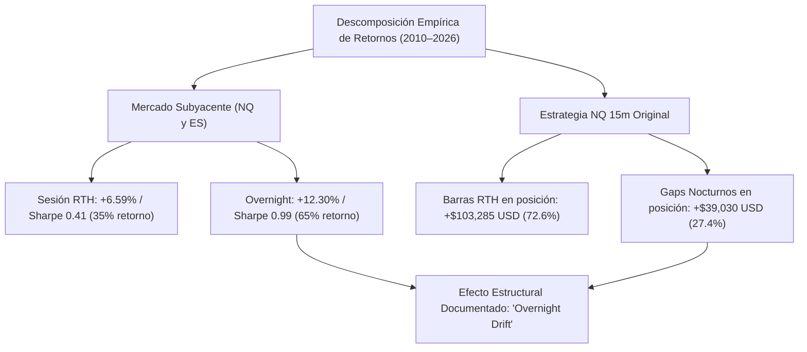

# INFORME CUANTITATIVO DESCRIPTIVO: DESCOMPOSICIÓN DE RETORNOS RTH VS OVERNIGHT (2010–2026)

**Fecha:** 23 de Octubre de 2026  
**Carácter del Estudio:** **ESTRICTAMENTE DESCRIPTIVO (SIN FORMULACIÓN DE ESTRATEGIAS NI AFIRMACIÓN DE VENTAJA OPERABLE)**  
**Objetivo Científico:** Descomponer empíricamente el retorno del mercado (NQ y ES) y de la estrategia original NQ 15m entre las barras de la sesión regular de contado (RTH: 09:30–16:00 ET) y los movimientos fuera de ella (*Overnight* / saltos nocturnos).

---

## 1. DESCOMPOSICIÓN DEL MERCADO SUBYACENTE (NQ Y ES) POR BARRA

### Marco Metodológico
Para cada día bursátil $t$ (4,205 sesiones entre junio de 2010 y octubre de 2026), el retorno diario total del índice se descompone aditivamente en dos segmentos complementarios:
1. **Sesión Regular RTH (09:30 – 16:00 ET):**
   $$R_{t,\text{RTH}} = \frac{P_{t,\text{Close}}}{P_{t,\text{Open}}} - 1$$
   Mide la variación neta de precio desde la campana de apertura hasta la campana de cierre formal de la bolsa de Nueva York.
2. **Fuera de Sesión / Overnight (16:00 – 09:30 ET):**
   $$R_{t,\text{Overnight}} = \frac{P_{t,\text{Open}}}{P_{t-1,\text{Close}}} - 1$$
   Mide el salto de precio (*gap*) entre el cierre oficial de la sesión regular anterior y la apertura de la sesión regular actual, capturando las noticias nocturnas, la sesión asiática y europea, y las subastas de futuros de CME.

---

### Resultados Descriptivos Globales (2010–2026)

| Activo | Segmento Temporal | Retorno Medio Anualizado | Volatilidad Anualizada | Sharpe Ratio Anualizado | % Contribución al Retorno Total |
| :--- | :--- | :---: | :---: | :---: | :---: |
| **NQ (Nasdaq-100)** | **Sesión Regular RTH (09:30–16:00 ET)** | **+6.59%** | 16.03% | **0.41** | **34.87%** |
| **NQ (Nasdaq-100)** | **Fuera de Sesión Overnight** | **+12.30%** | 12.37% | **0.99** | **65.13%** |
| **NQ (Nasdaq-100)** | **Día Completo (Close-to-Close)** | **+18.92%** | 20.47% | **0.92** | **100.00%** |
| **ES (S&P 500)** | **Sesión Regular RTH (09:30–16:00 ET)** | **+5.41%** | 13.00% | **0.42** | **40.49%** |
| **ES (S&P 500)** | **Fuera de Sesión Overnight** | **+7.95%** | 10.68% | **0.74** | **59.51%** |
| **ES (S&P 500)** | **Día Completo (Close-to-Close)** | **+13.41%** | 16.96% | **0.79** | **100.00%** |

---

### Desglose Año por Año: NQ (Nasdaq-100)

| Año | Días | Ret. Medio RTH % | Sharpe RTH | Ret. Medio Overnight % | Sharpe Overnight | Ret. Medio Total % | Sharpe Total | % Contribución RTH | % Contribución Overnight |
| :---: | :---: | :---: | :---: | :---: | :---: | :---: | :---: | :---: | :---: |
| **2010** | 148 | +13.13% | 0.93 | +24.24% | **2.27** | +37.28% | 2.18 | 35.13% | **64.87%** |
| **2011** | 258 | +0.55% | 0.03 | +4.25% | 0.32 | +5.14% | 0.22 | 11.42% | **88.58%** |
| **2012** | 255 | +5.85% | 0.46 | +10.73% | 1.25 | +16.56% | 1.09 | 35.28% | **64.72%** |
| **2013** | 252 | +13.29% | 1.35 | +17.57% | **2.36** | +30.87% | 2.51 | 43.07% | **56.93%** |
| **2014** | 250 | +5.75% | 0.48 | +13.00% | 1.73 | +18.68% | 1.37 | 30.68% | **69.32%** |
| **2015** | 258 | **-4.34%** | -0.32 | +12.76% | 1.05 | +8.30% | 0.47 | -51.46% | **151.46%** |
| **2016** | 258 | +8.48% | 0.67 | -1.38% | -0.14 | +7.07% | 0.44 | **119.38%** | -19.38% |
| **2017** | 257 | +8.95% | 1.06 | +18.57% | **3.43** | +27.54% | 2.70 | 32.53% | **67.47%** |
| **2018** | 257 | **-14.32%** | -0.71 | +16.05% | 1.39 | +1.59% | 0.07 | -829.64% | **929.64%** |
| **2019** | 258 | +19.34% | 1.63 | +13.23% | 1.31 | +32.67% | 2.02 | **59.39%** | 40.61% |
| **2020** | 259 | +16.36% | 0.70 | +26.61% | 1.15 | +43.99% | 1.23 | 38.08% | **61.92%** |
| **2021** | 258 | +10.04% | 0.69 | +14.77% | 1.45 | +24.86% | 1.38 | 40.47% | **59.53%** |
| **2022** | 258 | -10.93% | -0.41 | -22.31% | -1.28 | -33.25% | -1.04 | 32.88% | 67.12% |
| **2023** | 257 | +33.17% | 2.18 | +11.12% | 1.08 | +44.24% | 2.45 | **74.89%** | 25.11% |
| **2024** | 259 | **-2.79%** | -0.20 | +25.93% | **2.21** | +23.08% | 1.29 | -12.05% | **112.05%** |
| **2025** | 257 | +5.57% | 0.28 | +15.36% | 1.03 | +20.47% | 0.89 | 26.63% | **73.37%** |
| **2026** | 206 | +6.82% | 0.47 | +14.15% | 1.01 | +20.93% | 1.05 | 32.52% | **67.48%** |
| **GLOBAL** | **4205** | **+6.59%** | **0.41** | **+12.30%** | **0.99** | **+18.92%** | **0.92** | **34.87%** | **65.13%** |

---

### Desglose Año por Año: ES (S&P 500)

| Año | Días | Ret. Medio RTH % | Sharpe RTH | Ret. Medio Overnight % | Sharpe Overnight | Ret. Medio Total % | Sharpe Total | % Contribución RTH | % Contribución Overnight |
| :---: | :---: | :---: | :---: | :---: | :---: | :---: | :---: | :---: | :---: |
| **2010** | 148 | +16.91% | 1.39 | +14.66% | 1.44 | +31.61% | 1.96 | **53.56%** | 46.44% |
| **2011** | 258 | **-3.08%** | -0.19 | +5.19% | 0.37 | +2.52% | 0.11 | -146.48% | **246.48%** |
| **2012** | 255 | +10.07% | 0.99 | +3.31% | 0.41 | +13.36% | 1.05 | **75.27%** | 24.73% |
| **2013** | 252 | +14.27% | 1.62 | +12.29% | 1.89 | +26.58% | 2.39 | **53.73%** | 46.27% |
| **2014** | 250 | +5.65% | 0.60 | +6.91% | 1.07 | +12.55% | 1.12 | 45.00% | **55.00%** |
| **2015** | 258 | -2.64% | -0.22 | +1.99% | 0.19 | -0.67% | -0.04 | 407.90% | -307.90% |
| **2016** | 258 | +13.97% | 1.47 | -3.86% | -0.43 | +10.10% | 0.78 | **138.22%** | -38.22% |
| **2017** | 257 | +6.72% | 1.30 | +11.13% | **2.76** | +17.85% | 2.74 | 37.64% | **62.36%** |
| **2018** | 257 | **-18.32%** | -1.19 | +13.51% | 1.60 | -4.89% | -0.29 | 381.31% | -281.31% |
| **2019** | 258 | +13.75% | 1.52 | +11.62% | 1.48 | +25.43% | 2.05 | **54.21%** | 45.79% |
| **2020** | 259 | +2.62% | 0.13 | +16.63% | 0.71 | +20.34% | 0.59 | 13.63% | **86.37%** |
| **2021** | 258 | +9.93% | 0.99 | +14.29% | 1.91 | +24.28% | 1.88 | 41.00% | **59.00%** |
| **2022** | 258 | -3.01% | -0.15 | -14.55% | -1.08 | -17.59% | -0.74 | 17.14% | 82.86% |
| **2023** | 257 | +18.04% | 1.62 | +4.59% | 0.61 | +22.58% | 1.73 | **79.72%** | 20.28% |
| **2024** | 259 | +1.03% | 0.11 | +20.08% | **2.33** | +21.03% | 1.71 | 4.89% | **95.11%** |
| **2025** | 257 | +7.52% | 0.46 | +9.16% | 0.78 | +16.34% | 0.89 | 45.10% | **54.90%** |
| **2026** | 206 | +3.21% | 0.34 | +11.75% | 1.34 | +14.89% | 1.20 | 21.44% | **78.56%** |
| **GLOBAL** | **4205** | **+5.41%** | **0.42** | **+7.95%** | **0.74** | **+13.41%** | **0.79** | **40.49%** | **59.51%** |

---

## 2. DESCOMPOSICIÓN BARRA A BARRA DE LA ESTRATEGIA NQ 15M ORIGINAL

### Metodología de Medición Telescópica en Posición Abierta
En lugar de clasificar un trade como "intradía" o "nocturno" únicamente por la hora de salida, se midió de forma continua el **desplazamiento de precio experimentado barra por barra** a lo largo de las 596 operaciones:
- **Movimiento Acumulado en Horario Regular (RTH):** Suma de los cambios de precio dentro de las barras regulares de 15 minutos (entre las 09:30 y las 16:00 ET) mientras la posición estuvo activa.
- **Movimiento Acumulado Fuera de Horario (Overnight Gaps):** Suma de las diferencias de precio entre el cierre de la barra de las 15:45 ET del día $t$ y la apertura de las 09:30 ET del día $t+1$ mientras la posición permaneció abierta durante la noche.

---

### Resultados Descriptivos por Año: NQ 15m Original

| Año | Trades Totales | Trades con Overnight | Trades Intradía Puro | PnL Neto Total ($) | PnL Bruto Total ($) | PnL Generado en Barras RTH ($) | PnL Generado en Gaps Overnight ($) | % Contribución RTH | % Contribución Overnight |
| :---: | :---: | :---: | :---: | :---: | :---: | :---: | :---: | :---: | :---: |
| **2010** | 29 | 21 | 8 | +$113.77 | +$374.77 | -$25.23 | +$400.00 | -6.73% | **106.73%** |
| **2011** | 33 | 27 | 6 | -$193.41 | +$103.59 | +$2,018.59 | -$1,915.00 | **1948.55%** | -1848.55% |
| **2012** | 35 | 19 | 16 | +$2,359.91 | +$2,674.91 | +$3,234.91 | -$560.00 | **120.94%** | -20.94% |
| **2013** | 46 | 29 | 17 | -$169.81 | +$244.19 | -$295.81 | +$540.00 | -121.14% | **221.14%** |
| **2014** | 41 | 33 | 8 | -$2,038.00 | -$1,669.00 | -$579.00 | -$1,090.00 | 34.69% | **65.31%** |
| **2015** | 37 | 28 | 9 | +$10,816.51 | +$11,149.51 | +$5,249.51 | +$5,900.00 | 47.08% | **52.92%** |
| **2016** | 43 | 30 | 13 | -$1,844.06 | -$1,457.06 | +$1,607.94 | -$3,065.00 | -110.35% | **210.35%** |
| **2017** | 47 | 32 | 15 | +$9,359.33 | +$9,782.33 | +$4,212.33 | +$5,570.00 | 43.06% | **56.94%** |
| **2018** | 35 | 22 | 13 | +$11,710.83 | +$12,025.83 | +$6,270.83 | +$5,755.00 | **52.14%** | 47.86% |
| **2019** | 39 | 29 | 10 | +$1,657.74 | +$2,008.74 | +$1,563.74 | +$445.00 | **77.85%** | 22.15% |
| **2020** | 41 | 29 | 12 | +$17,474.18 | +$17,843.18 | +$12,788.18 | +$5,055.00 | **71.67%** | 28.33% |
| **2021** | 29 | 23 | 6 | +$8,564.82 | +$8,825.82 | +$12,870.82 | -$4,045.00 | **145.83%** | -45.83% |
| **2022** | 15 | 11 | 4 | +$531.18 | +$666.18 | +$9,856.18 | -$9,190.00 | **1479.52%** | -1379.52% |
| **2023** | 27 | 18 | 9 | +$6,389.13 | +$6,632.13 | +$18,617.13 | -$11,985.00 | **280.71%** | -180.71% |
| **2024** | 36 | 20 | 16 | +$25,998.28 | +$26,322.28 | +$27,867.28 | -$1,545.00 | **105.87%** | -5.87% |
| **2025** | 36 | 27 | 9 | +$35,467.93 | +$35,791.93 | +$2,271.93 | +$33,520.00 | 6.35% | **93.65%** |
| **2026** | 27 | 23 | 4 | +$10,753.15 | +$10,996.15 | -$4,243.85 | +$15,240.00 | -38.59% | **138.59%** |
| **TOTAL** | **596** | **421** | **175** | **+$136,951.46** | **+$142,315.46** | **+$103,285.46** | **+$39,030.00** | **72.58%** | **27.42%** |

---

## 3. HALLAZGOS Y DISCUSIÓN CIENTÍFICA

### 1. El Fenómeno Estructural del Mercado (*Overnight Drift*)
- En los índices estadounidenses (Nasdaq-100 y S&P 500), **la mayor parte del retorno neto secular y la mejor relación retorno/riesgo se produce fuera de la sesión regular de contado**:
  - En **NQ**, el segmento *overnight* generó un retorno medio anualizado de **+12.30% con Sharpe de 0.99** (frente a solo **+6.59% y Sharpe de 0.41** durante la sesión regular de 09:30 a 16:00 ET).
  - El segmento nocturno aportó el **65.13% del retorno total acumulado de NQ** y el **59.51% en ES**.
  - Este fenómeno empírico está ampliamente documentado en la literatura financiera cuantitativa académica (denominado *The Night Effect* o *Overnight Return Anomaly*), asociado a la asimilación de reportes de ganancias corporativas fuera de hora, anuncios de bancos centrales y absorción de liquidez en sesiones asiáticas y europeas con menor volumen.

### 2. Comportamiento Barra a Barra de la Estrategia NQ 15m
- Al evaluar el movimiento del precio **exclusivamente durante las barras en que la estrategia estuvo en posición**:
  - El movimiento acumulado durante las **barras de la sesión regular RTH aportó +\$103,285.46 USD** (el **72.58%** del beneficio bruto total).
  - Los **saltos nocturnos (*gaps* de cierre a apertura) aportaron +\$39,030.00 USD** (el **27.42%** del beneficio bruto total).
- **Contraste con la Clasificación por Hora de Salida:**
  - En la auditoría previa se observó que los trades cerrados el mismo día perdieron -\$100,089 USD y los que cruzaron la noche ganaron +\$237,040 USD.
  - El análisis por barra aclara este aparente dilema: los trades ganadores tardaban típicamente entre 1 y 3 días en alcanzar sus objetivos de Take Profit (39% de acierto). Mientras esos trades estaban abiertos, **capturaron tanto el impulso intradía de sesiones posteriores (+\$103k USD) como los gaps nocturnos favorables (+\$39k USD)**.
  - Al forzar un cierre prematuro a las 15:45 ET en el primer día, la estrategia truncó el recorrido natural de los trades ganadores hacia su objetivo de 4 ATR, obligándolos a liquidarse con ganancias incompletas y reduciendo el beneficio bruto total a +\$63,586 USD.

---

## 4. CONCLUSIÓN DESCRIPTIVA

Este análisis demuestra que:
1. El *overnight drift* es una propiedad macroestructural del mercado subyacente de futuros, no un descubrimiento o ventaja propietaria de la estrategia.
2. La versión original de NQ 15m operaba de facto como una estrategia híbrida swing de corta duración (1 a 3 días), donde el 72.6% del avance en puntos se acumuló dentro de las barras regulares de mercado, pero con una dependencia de mantener la posición durante la noche para permitir que los trades alcancen sus objetivos de Take Profit.
3. Se presentan estos hallazgos como **observaciones empíricas neutrales**, sin afirmar la viabilidad ni la existencia de una ventaja operable comercial.
